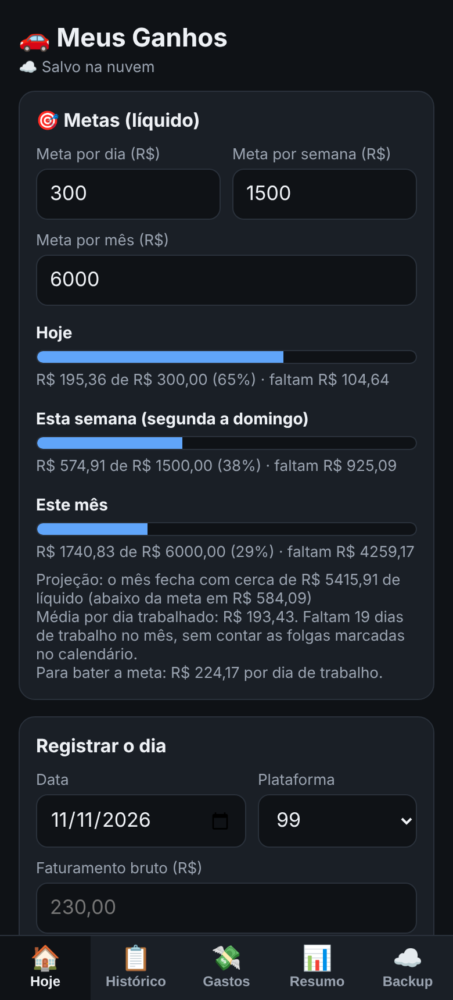
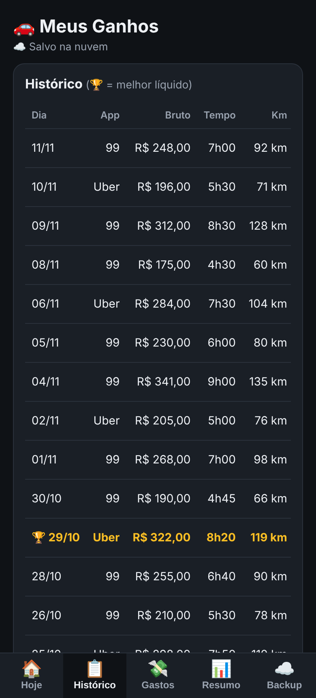
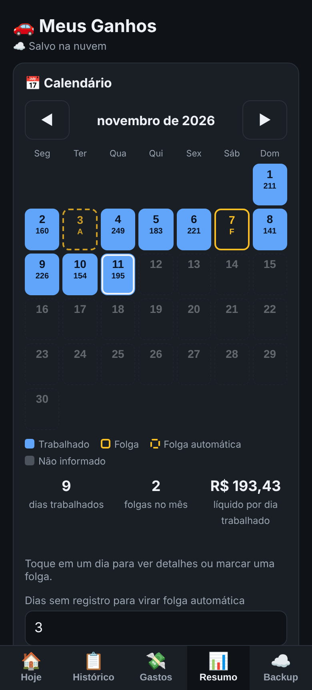
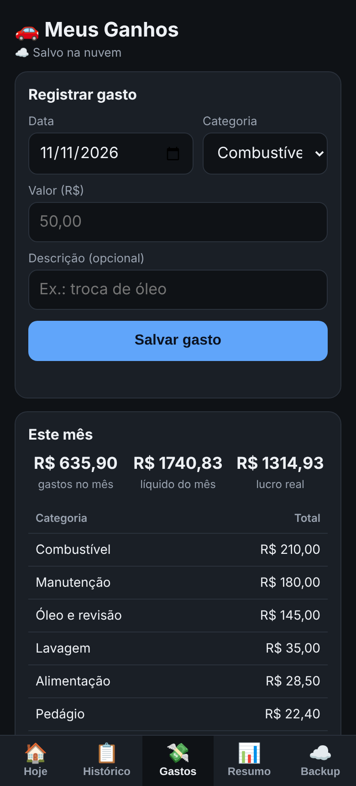
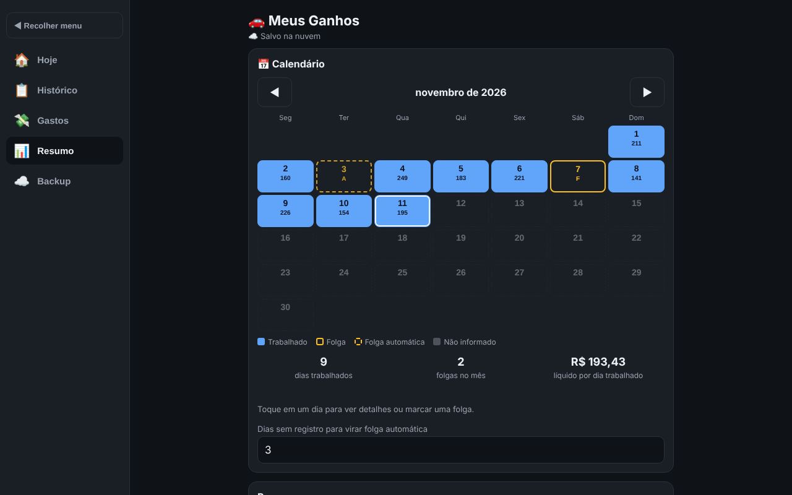

# 🚗 Meus Ganhos

Web app para motoristas de aplicativo (99 e Uber) acompanharem ganhos, gastos, metas e dias de folga. Funciona no celular e no computador, sem login e sem instalar nada.

**🔗 Demo:** https://caioeduardotech-ui.github.io/meus-ganhos/

| Hoje | Histórico |
|---|---|
|  |  |

| Resumo e calendário | Gastos |
|---|---|
|  |  |

**Versão para computador** (menu lateral recolhível):



## Por que fiz

Meu pai trabalha com 99 e Uber como renda extra e anotava os ganhos de cada dia em mensagens e tabelas soltas. Criei este app para ele registrar o dia em poucos toques e enxergar quanto realmente sobra depois do combustível e dos outros gastos.

## Funcionalidades

- **Registro do dia:** plataforma (99, Uber ou os dois), faturamento bruto, tempo trabalhado, km, média de consumo, preço do litro, outros gastos e número de corridas.
- **Cálculo automático:** ganho por km, por hora, por corrida e líquido (descontado o combustível estimado).
- **Metas:** por dia, semana e mês, com barras de progresso e **projeção de fechamento do mês** (usa a média por dia trabalhado e as folgas marcadas).
- **Calendário:** dias trabalhados aparecem sozinhos; folgas são marcadas por toque; dias sem registro por mais de N dias (padrão 3) viram **folga automática**.
- **Gastos:** manutenção, pneus, pedágio, alimentação etc., com resumo por categoria e **lucro real** do mês.
- **Resumo:** por semana e por mês, e comparação **99 x Uber** (R$/km, R$/hora, R$/corrida).
- **Calculadora de consumo ("prova real"):** confere o km/L real a cada abastecimento.
- **Histórico** com editar, apagar e copiar para o WhatsApp.
- **Backup** e **sincronização na nuvem** sem login (código secreto + link de acesso).
- **Layout responsivo:** barra de abas embaixo no celular e menu lateral recolhível no computador. Modo claro e escuro automáticos.

## Tecnologias

- HTML, CSS e JavaScript puro, em um único arquivo (sem frameworks nem etapa de build)
- **Firebase Firestore** via API REST, para salvar na nuvem
- `localStorage` para funcionar offline
- **GitHub Pages** para hospedagem

## Estrutura do projeto

```
meus-ganhos/
├── index.html   # estrutura, estilos (CSS) e lógica (JavaScript) em um único arquivo
└── README.md
```

## Como a sincronização funciona

1. Na primeira vez, o app gera um **código secreto** aleatório (28 caracteres) e guarda no aparelho.
2. Os dados ficam em um documento do Firestore cujo ID é esse código.
3. Para usar em outro aparelho, abre-se o **link de acesso** (`...#c=CODIGO`), que leva o código.
4. Ao abrir, o app compara a data da última alteração local e a da nuvem, e vale a mais recente.

Não há login: o código funciona como senha. Quem tem o código lê e altera os dados daquele documento.

## Estrutura dos dados

```json
{
  "dias":   [{ "id", "data", "plat", "fat", "min", "km", "med", "preco", "out", "corr" }],
  "gastos": [{ "id", "data", "cat", "val", "desc" }],
  "folgas": ["2026-11-08"],
  "meta":   { "dia", "semana", "mes" },
  "espera": 3,
  "preco":  3.49,
  "t":      1794368931205
}
```

## Rodando localmente

Basta abrir o `index.html` no navegador. Sem a configuração do Firebase, o app funciona normalmente salvando só no aparelho.

Para usar o seu próprio banco, crie um projeto no Firebase, ative o Firestore e troque `FB.key` e `FB.pid` no início do bloco de sincronização do `index.html`. As regras do Firestore usadas:

```
rules_version = '2';
service cloud.firestore {
  match /databases/{database}/documents {
    match /ganhos/{codigo} {
      allow get, delete: if true;
      allow create, update: if request.resource.data.json is string
                            && request.resource.data.json.size() < 300000;
    }
  }
}
```

> A chave do Firebase de apps web não é segredo. A proteção está nas regras do banco e no código aleatório de cada usuário.

## Limitações conhecidas

- Quem souber o código pode ler e alterar os dados daquele usuário (sem login por escolha de projeto).
- Se dois aparelhos editarem ao mesmo tempo, vale a alteração mais recente.
- O lucro real considera o combustível pela estimativa (km ÷ média × preço), não pelo valor pago no posto.

## Próximos passos

- [ ] Gráficos de evolução diária, semanal e mensal
- [ ] Lembrete de manutenção por km rodado
- [ ] Exportar histórico e gastos em CSV
- [ ] Link somente leitura
- [ ] Instalar como app (PWA)
- [ ] Regras do Firestore mais restritivas

## Autor

Desenvolvido por [@caioeduardotech-ui](https://github.com/caioeduardotech-ui).
